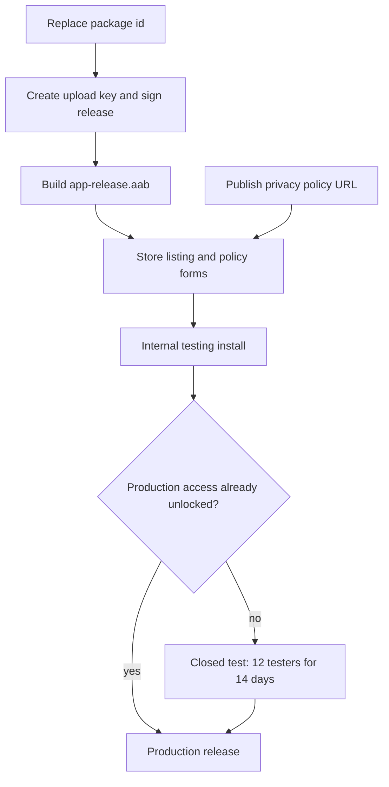

# Prepare Rummy Tracker for Google Play

The app in [rummy_tracker](rummy_tracker) is a free, offline scorekeeper (English and Bosnian). It has no accounts, ads, purchases, or network code. Player names and scores stay in `shared_preferences` on the device. Flutter **3.44.2** already sets `minSdk 24`, `targetSdk 36`, and `compileSdk 36`, with NDK `28.2.13676358` (16 KB page alignment). That meets Play’s current target-API requirement. Do not change those SDK numbers.

Steps 1 and 2 are done. [rummy_tracker/android/app/build.gradle.kts](rummy_tracker/android/app/build.gradle.kts) now uses `com.rummy.tracker`, and the release build type is signed with the upload keystore at `C:\Users\Administrator\keystores\rummy-tracker-upload.jks`. Passwords live only in gitignored `rummy_tracker/android/key.properties`. Back both files up before the first Play upload. The package id cannot be changed after that upload.

Version `3.1.2+1` in [rummy_tracker/pubspec.yaml](rummy_tracker/pubspec.yaml) is fine for the first upload (`versionName` 3.1.2, `versionCode` 1). iOS stays untouched.



## 1. Permanent Android package id

Change `namespace` and `applicationId` from `com.example.rummy_tracker` to **`com.rummy.tracker`**. Move [MainActivity.kt](rummy_tracker/android/app/src/main/kotlin/com/example/rummy_tracker/MainActivity.kt) to `kotlin/com/rummy/tracker/` and update its `package` line.

This id cannot be changed after the first Play upload. Say so before implementation if a different id is required.

## 2. Upload keystore

Create an upload keystore **outside the repo**, for example `C:\Users\Administrator\keystores\rummy-tracker-upload.jks`:

```bat
keytool -genkeypair -v -keystore C:\Users\Administrator\keystores\rummy-tracker-upload.jks -storetype JKS -keyalg RSA -keysize 2048 -validity 10000 -alias upload
```

Add `rummy_tracker/android/key.properties` (already gitignored, along with `*.jks`) pointing at that file, and wire a `release` `signingConfig` in [build.gradle.kts](rummy_tracker/android/app/build.gradle.kts). Passwords stay only in `key.properties` and in an offline backup of the `.jks`. New Play apps use Play App Signing: Google holds the app signing key, and this file is only the upload key. Losing it blocks updates until Play support resets the upload key.

## 3. Privacy policy and store copy

Done as the Angular site in [rummy-tracker-web](rummy-tracker-web). Deploy that folder on Vercel. The Play Console privacy policy URL is `https://<your-vercel-domain>/privacy`. Listing text, in English and Bosnian, is on `/listing`. Contact on the policy is Vedad Keskin, vedad.keskin98@gmail.com.

## 4. Release bundle

From `rummy_tracker`:

```bat
flutter build appbundle --release
```

Upload only `rummy_tracker/build/app/outputs/bundle/release/app-release.aab`. Do not upload an APK. The README’s `flutter build apk` command is for local installs only.

## 5. Store assets you still need

Play will not accept the release without these. Existing launcher mipmaps are not the store icon.

- Hi-res icon: 512×512 PNG, under 1 MB, full square, no rounded mask.
- Feature graphic: 1024×500 PNG or JPEG.
- Phone screenshots: at least 2, preferably 4–8, portrait, from splash, menu, score table, winner, players, and rankings. Min side 320 px, max 3840 px, no alpha.
- Optional: a 7-inch tablet set. Not required if the listing is phone-only.

After the plan is approved, screenshots can be captured from a device or emulator, and the icon plus feature graphic can be exported from the existing logo.

## 6. Play Console, in order

You already have the developer account. Create the app in [Play Console](https://play.google.com/console) as **Rummy Tracker**, default language English, type **App**, free.

Complete **Policy and programs** with these answers, which match the code:

- Privacy policy: the https URL from step 3.
- App access: all features work with no login.
- Ads: no.
- Content rating (IARC): card scorekeeper, no violence, no sexual content, no user chat, no location sharing, no digital purchases, no real-money or simulated gambling. Expected result is Everyone / PEGI 3.
- Target audience: not a children’s app. Select ages that start at 13 or older so the Families program does not apply.
- News, COVID/health, government: no.
- Financial features: none. This is the important one. The app only records scores. It does not take stakes, sell chips, or link to gambling sites. If a review flags the word “Rummy”, reply that it is an offline scorekeeper.
- Data safety: data is not collected and not shared. Names and scores never leave the device, so they are not “collected” under Play’s definition. No advertising ID. The release manifest has no `INTERNET` permission (only debug/profile manifests do).
- Category: **Game → Cards**. Tags along the lines of “Card” and “Score”.

Then **Store listing**: paste the copy, upload the icon, feature graphic, and screenshots.

Then **Release**:

1. Countries: all countries, unless you want to exclude one.
2. Create an **Internal testing** release, upload the AAB, and enroll Play App Signing when asked.
3. Add yourself as a tester, install from the Play link, and run a full game: add players, enter a round, close the app, resume, finish, check rankings.
4. Production:
   - If this Play account can already publish to production, promote the same release.
   - If the account is a personal account created after 13 November 2023 and production is still locked, use a **Closed testing** track with at least **12 testers opted in for 14 consecutive days**, then apply for production access. An internal test does not count toward that requirement. Organization accounts are not subject to that wait.

Review after you submit production often takes from a few hours to several days. The first upload from a new app can take longer.

## What stays out of scope

- iOS bundle id (`com.example.rummyTracker`) and App Store.
- Ads, billing, accounts, or a backend.
- Changing `versionCode` beyond `1` for this first upload.
